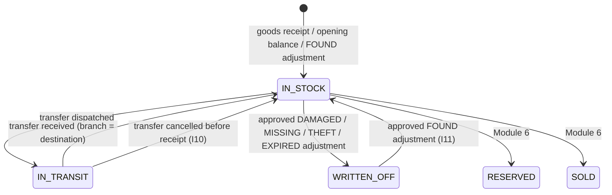
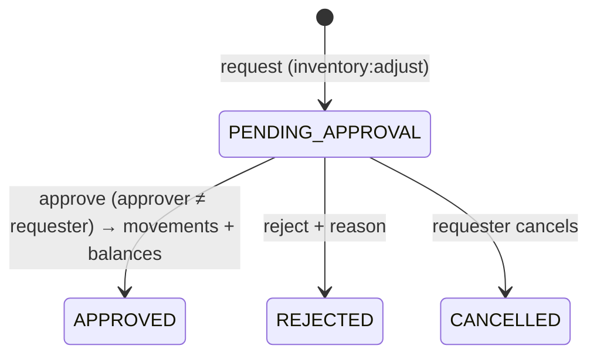
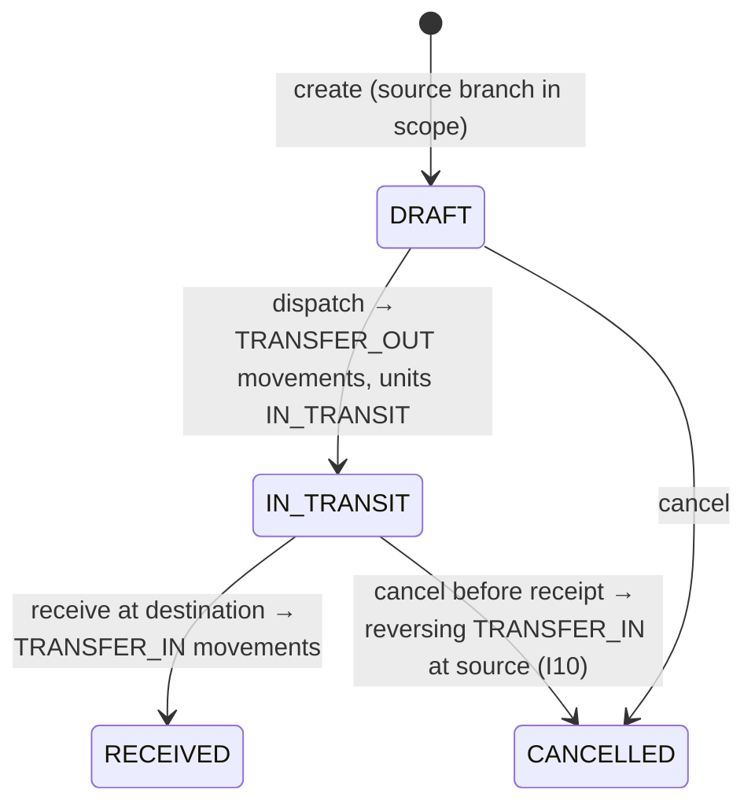

# Module 5 — Inventory Management & Goods Receiving: Proposal

**Status:** APPROVED by the project owner on 16 Nov 2026 (decisions I1–I22, §13). Implemented in stages (§0).
**Prepared:** 16 Nov 2026, from `main` @ `cd7eb85` (Modules 1–4 complete; 172 unit / 230 e2e tests).
**Decisions:** I1–I22 approved as recommended, with **I4 = creator, submitter and approver** (§13).

---

## 0. Delivery phasing (owner instruction, 16 Nov 2026: interview-ready MVP)
| Stage | Content | Status |
|---|---|---|
| **5.1 Essential inventory (this delivery)** | Receiving against APPROVED/PARTIALLY_RECEIVED POs (partial and complete); serialized unit registration with IMEI/serial validation and organisation-wide uniqueness; quantity receiving; append-only ledger and per-branch balances; BR-14 (creator, submitter, approver) in service **and** DB; mandatory idempotency (I19); WAC valuation (I1); read APIs (receipts, balances incl. low-stock filter, movements, units, lookup with I15, valuation incl. in-transit column, I18) | Implemented |
| **5.2 Deferred, design approved and preserved** | Close short with the CLOSED status (I6); stock adjustments incl. reasons, two-step approval, the `inventory:adjust_approve` permission and opening balances (I7, I8, I9, I13); two-step transfers incl. SoD and discrepancy handling (I10, I10b, I10c, I16); reconciliation endpoint | **Not implemented.** No partial versions exist; no tables, endpoints or permissions for them were added |
| Deferred by decision | Physical counts (I14); goods-receipt reversal (I12) | Out of MVP |

**Consequences of the deferral (documented limitations):** a partially received PO can't yet be closed short; stock can only enter through receiving (no opening balances yet); stock can't move between branches; stock can't be corrected except by future adjustments. The schema includes `IN_TRANSIT` (I11) and the full `MovementType` enum, so 5.2 needs no enum changes.

---

## 1. Purpose and scope

Turn approved purchase orders into physical stock, keep an **append-only, auditable ledger** of every stock change, maintain **per-branch balances**, and support **adjustments, transfers, opening stock and valuation**, all while respecting the existing RBAC, branch isolation, audit and separation-of-duties rules.

### In scope
| # | Capability | Requirements |
|---|---|---|
| 1 | Goods receiving against APPROVED/PARTIALLY_RECEIVED purchase orders, partial and complete | FR-PUR-03, FR-PUR-04, US-04, BR-06 |
| 2 | Serialized unit registration with IMEI/serial validation and organisation-wide uniqueness | FR-UNIT-01..03, FR-UNIT-05, D3 |
| 3 | Quantity-based receiving | FR-INV-01 |
| 4 | Stock movement ledger (append-only) and per-branch balances | FR-INV-01, FR-INV-02, BR-04 |
| 5 | Stock adjustments: damaged, missing, found, count correction, write-off | FR-INV-03, FR-INV-04 |
| 6 | Inter-branch transfers with in-transit tracking | FR-INV-05 |
| 7 | Opening stock (go-live balances) through audited adjustments | D2 |
| 8 | Over/under-receiving rules; closing a purchase order short | Module 4 hand-off |
| 9 | Inventory valuation (method per I1) | FR-RPT-03, P14 |
| 10 | BR-14: a purchase order's creator and approver can never receive it | BR-14, ADR-028 |
| 11 | Inventory read APIs: balances, movements, units, low stock, valuation, reconciliation | US-05, FR-INV-07, FR-RPT-03 |

### Explicitly excluded (later modules or deferred)
| Excluded | Where |
|---|---|
| Sales, reservation at checkout, SOLD/RETURNED transitions | Module 6 (POS) |
| Warranty, UNDER_REPAIR transitions | Warranty/Repair modules |
| Supplier invoices, payments, cost variances, accounting entries | Out of MVP |
| Physical stock counts / cycle-count sessions (FR-INV-06, Should) | I14: recommended deferral; corrections via adjustments |
| Barcode scanning hardware, label printing | Later release (D14) |
| Multi-location (shelf/bin) within a branch | Out of MVP |
| CSV export of reports | Reports module (FR-RPT-04) |
| Reversal of a posted goods receipt | I12 (recommended: corrections via adjustments) |

### Preservation of Modules 1–4
- No changes to existing permissions' meaning. The only grant changes are those you approve in I8/I9.
- Module 4 changes are limited to what receiving requires:
  - writing `purchase_items.quantity_received` (the hook built in Module 4);
  - the PARTIALLY_RECEIVED/RECEIVED transitions;
  - **if I6 is approved**, a new `CLOSED` status with its columns and an updated status-consistency CHECK.
- `Product.costPrice` (catalogue, governed by `catalogue:price`, D5) is **not** modified by receiving (I2).
- All 230 existing e2e and 172 unit tests must stay green.

---

## 2. Requirements and user stories

### New or refined requirements (proposed IDs)
- **FR-INV-08:** Goods are received only against APPROVED or PARTIALLY_RECEIVED purchase orders, by a user with `inventory:receive` and access to the order's branch.
- **FR-INV-09:** A receipt records the receiving user, timestamp, supplier delivery note / invoice reference, lines, quantities and (for serialized products) every unit's identifiers.
- **FR-INV-10:** Every stock change writes one or more immutable movement rows **and** updates the balance in the same transaction; balances must always equal the sum of movements.
- **FR-INV-11:** Each inventory write accepts an idempotency key; a retried request never applies twice (BR-06).
- **FR-INV-12:** Inventory responses omit costs for users without `catalogue:cost_read`.
- **BR-14 (existing):** creator and approver of a PO can never receive it (partial or final).
- **BR-16 (proposed):** On-hand stock can never be negative (DB CHECK). Serialized on-hand always equals the number of IN_STOCK units at that branch.
- **BR-17 (proposed):** Serial/IMEI identifiers are never reused, even after write-off.

### User stories
- **US-04 (extended): receive stock.** As an inventory officer, I receive goods against an approved PO for my branch.
  - Quantities are whole numbers and never exceed what remains outstanding (I3).
  - Serialized products need exactly `identifiersPerUnit` valid, unique identifiers per unit.
  - Receiving is atomic and retry-safe.
  - I cannot receive a PO I created or approved (BR-14).
- **US-05 (existing): view branch stock.** On-hand, reserved and available quantities; drill into serialized units.
- **US-17: close a PO short.** As a manager, I close a partially received PO when the remainder won't arrive, with a reason.
- **US-18: adjust stock.** As an inventory officer, I record damaged, missing, found or corrected stock with a reason. Decreases (and possibly all adjustments, I8) require a manager's approval.
- **US-19: transfer stock.** As an inventory officer, I dispatch stock to another branch. Stock leaves my branch at dispatch and appears at the destination only when it is received there.
- **US-20: opening stock.** As an administrator, I load go-live balances, including serials, as audited opening-balance entries with unit cost.
- **US-21: low stock.** As a manager, I see products at or below their reorder level in my branches.
- **US-22: valuation.** As a manager or auditor, I see stock value per branch and product using the approved method (I1).

---

## 3. Inventory valuation (I1, I2)

### Options compared
| Method | How it works | Advantages | Disadvantages |
|---|---|---|---|
| **Last purchase cost (LPC)** | Value all units of a product at the most recent receipt cost | Simplest; a single number per product | Not a real cost-flow method: one expensive receipt revalues all existing stock; margins distorted; not accepted under IFRS/IAS 2 for valuation |
| **Moving weighted average (WAC)** | On each receipt: `newAvg = (onHandQty × oldAvg + receivedQty × unitCost) / (onHandQty + receivedQty)`. Issues (sales, write-offs, transfers) leave it unchanged | Accepted by IAS 2; smooths price swings; one value per product; transfers and write-offs need no cost layers; easy to test | Needs care with decimal rounding; average can lag sharp price changes |
| **FIFO** | Consume oldest cost layers first | Accepted by IAS 2; matches physical flow for many goods | Needs cost-layer tables and layer consumption on every issue, transfer and write-off; considerably more code and tests |
| **Specific identification** | Each serialized unit carries its own receipt cost | Exact for high-value serialized devices (phones, laptops); natural with ProductUnit | Doesn't apply to quantity products; still needs a second method for them |

### Recommendation (I1)
**Moving weighted-average cost (WAC), organisation-wide per product**, recalculated on every stock **increase that carries a cost** (receipt, opening balance, "found" adjustment at the current average).
- Store the receipt unit cost on every movement row, and on every serialized unit (`ProductUnit.unitCost`) for traceability and possible later specific identification.
- Decreases (write-off, damage, transfer-out, and later sales) are valued at the current average and don't change it.
- **Transfers move stock at the current average** (organisation-wide), so no cost changes on transfer.
- Rounding: average stored as `Decimal(18,4)`; money totals rounded half-up to 2 decimals; unit tests pin the formula.
- If on-hand is zero across the organisation at a receipt, the new average equals that receipt's unit cost.

**Why organisation-wide rather than per branch:** prices are organisation-wide (D8), transfers stay cost-neutral, and it is simpler to test. Per-branch WAC is an option (I1-b) if branches buy from different suppliers at very different prices.

### Relationship to `Product.costPrice` (I2)
| Option | Effect |
|---|---|
| **(a) Recommended:** keep `Product.costPrice` as the catalogue **reference cost** (changed only by `catalogue:price`, D5); keep the WAC in a separate `inventory_valuations` row per product | Receivers never change catalogue prices (D5 preserved); valuation is system-calculated |
| (b) Receiving overwrites `Product.costPrice` with WAC or LPC | Bypasses D5 (receivers would change prices without `catalogue:price`); catalogue history mixes manual and automatic changes |

---

## 4. Data model

### New enums
- `MovementType`: `OPENING_BALANCE`, `PURCHASE_RECEIPT`, `ADJUSTMENT_INCREASE`, `ADJUSTMENT_DECREASE`, `TRANSFER_OUT`, `TRANSFER_IN`. Module 6 will add `SALE` and `SALE_RETURN`.
- `UnitStatus`: `IN_STOCK`, `IN_TRANSIT` *(new, I11)*, `RESERVED`, `SOLD`, `RETURNED`, `UNDER_REPAIR`, `WRITTEN_OFF`. Module 5 uses IN_STOCK, IN_TRANSIT and WRITTEN_OFF only.
- `AdjustmentReason`: `OPENING_BALANCE`, `DAMAGED`, `MISSING`, `FOUND`, `COUNT_CORRECTION`, `THEFT`, `EXPIRED_OBSOLETE`, `OTHER` (I7).
- `AdjustmentStatus`: `PENDING_APPROVAL`, `APPROVED`, `REJECTED`, `CANCELLED` (if I8 = two-step).
- `TransferStatus`: `DRAFT`, `IN_TRANSIT`, `RECEIVED`, `CANCELLED` (I10).

### Tables
| Model | Key fields | Rules / constraints |
|---|---|---|
| **GoodsReceipt** | id, reference `GRN-{BRANCH}-{YYYY}-{NNNNNN}` (UNIQUE), purchaseId, branchId, receivedById, receivedAt, supplierDeliveryRef?, supplierInvoiceRef? (FR-PUR-06), notes?, **idempotencyKey (UNIQUE)**, requestHash | Insert-only. BR-14 trigger: `received_by_id` ∉ {purchase.created_by_id, purchase.approved_by_id} (+ submitter if I4). Branch = purchase's branch |
| **GoodsReceiptItem** | id, goodsReceiptId, purchaseItemId, productId, quantity (Int > 0), unitCost (copied from PO line) | UNIQUE (goodsReceiptId, purchaseItemId) |
| **ProductUnit** | id, productId, branchId, status, unitCost (receipt cost), goodsReceiptItemId?, adjustmentItemId?, createdAt, updatedAt | Serialized products only (trigger checks the product's tracking mode). Branch required; status enum |
| **UnitIdentifier** | id, productUnitId, type (IMEI/SERIAL), value (normalised), isPrimary | **UNIQUE (value) across the organisation, forever** (D3, BR-17). UNIQUE (productUnitId, isPrimary) where primary. Count per unit = product's `identifiersPerUnit` (service + trigger) |
| **StockBalance** | productId + branchId (UNIQUE), onHand Int, reserved Int (0 in MVP, I13), updatedAt | `CHECK on_hand >= 0`, `reserved >= 0`, `reserved <= on_hand`. Available = onHand − reserved (computed) |
| **StockMovement** | id, productId, branchId, movementType, quantityDelta (Int ≠ 0), unitCost, valueDelta, productUnitId?, referenceType (`GOODS_RECEIPT` \| `ADJUSTMENT` \| `TRANSFER`), referenceId, actorId, idempotencyKey?, createdAt | **Append-only** (trigger blocks UPDATE/DELETE, like `audit_logs`). Serialized: one row per unit (±1); quantity products: one row per line |
| **InventoryValuation** | productId (PK), averageCost Decimal(18,4), updatedAt | Updated only inside stock-increase transactions (I1) |
| **StockAdjustment** | id, reference `ADJ-{BRANCH}-{YYYY}-{NNNNNN}`, branchId, reason, status, notes, requestedById/At, approvedById/At, rejectedById/At, rejectionReason, idempotencyKey (UNIQUE) | SoD CHECK: approver/rejecter ≠ requester (if I8 = two-step). Stock applied only on approval |
| **StockAdjustmentItem** | id, adjustmentId, productId, quantityDelta (Int ≠ 0), unitCost? (required for OPENING_BALANCE/FOUND-new), identifiers? (serialized increases), productUnitId? (serialized decreases) | Decrease lines reference existing IN_STOCK units at that branch |
| **StockTransfer** | id, reference `TRF-{FROM}-{YYYY}-{NNNNNN}`, fromBranchId, toBranchId (CHECK ≠), status, createdById, dispatchedById/At, receivedById/At, cancelledById/At, cancellationReason, idempotencyKeys | SoD CHECK if I10b: receiver ≠ dispatcher |
| **StockTransferItem** | id, transferId, productId, quantity (Int > 0); serialized units via **StockTransferUnit** (transferItemId, productUnitId) | UNIQUE unit per transfer |
| **Purchase** (Module 4 change) | + `CLOSED` status, closedById/At, closeReason (I6) | Status-consistency CHECK extended |

Sequences reuse `document_sequences` (scopes `GRN:{BRANCH}:{YYYY}`, `ADJ:…`, `TRF:…`).

### ERD additions (to be added to `04-erd.mmd` on approval)
```
PURCHASE 1──* GOODS_RECEIPT 1──* GOODS_RECEIPT_ITEM *──1 PURCHASE_ITEM
GOODS_RECEIPT_ITEM 1──* PRODUCT_UNIT 1──* UNIT_IDENTIFIER
PRODUCT 1──* PRODUCT_UNIT *──1 BRANCH
PRODUCT 1──* STOCK_BALANCE *──1 BRANCH
PRODUCT 1──* STOCK_MOVEMENT *──1 BRANCH ; STOCK_MOVEMENT *──0..1 PRODUCT_UNIT
PRODUCT 1──1 INVENTORY_VALUATION
BRANCH 1──* STOCK_ADJUSTMENT 1──* STOCK_ADJUSTMENT_ITEM
BRANCH(from/to) 1──* STOCK_TRANSFER 1──* STOCK_TRANSFER_ITEM 1──* STOCK_TRANSFER_UNIT *──1 PRODUCT_UNIT
USER 1──* GOODS_RECEIPT / STOCK_MOVEMENT / STOCK_ADJUSTMENT / STOCK_TRANSFER (actors)
```

---

## 5. Lifecycles and state diagrams

### Purchase order (extends Module 4)

```mermaid
stateDiagram-v2
  APPROVED --> PARTIALLY_RECEIVED: receive (some lines outstanding)
  APPROVED --> RECEIVED: receive (all lines complete)
  PARTIALLY_RECEIVED --> PARTIALLY_RECEIVED: receive more
  PARTIALLY_RECEIVED --> RECEIVED: receive remainder
  PARTIALLY_RECEIVED --> CLOSED: close short + reason (I6)
  APPROVED --> CANCELLED: cancel (nothing received; Module 4)
```


### Serialized unit (extends the existing diagram)


### Stock adjustment (if I8 = two-step)


### Stock transfer (I10 = two-step)


---

## 6. Business rules

### Receiving
1. The PO must be APPROVED or PARTIALLY_RECEIVED; the branch must be active; the receiver must have the PO's branch in scope and hold `inventory:receive`.
2. **BR-14:** receiver ∉ {creator, approver} (+ submitter if I4). Enforced in the service **and** by a DB trigger. Blocked attempts are audited (`goods_receipt.blocked`).
3. Lines reference PO lines; quantity is a whole number > 0 and ≤ outstanding (`ordered − received`), unless a tolerance is approved (I3).
4. Serialized lines: exactly `quantity × identifiersPerUnit` identifiers, grouped per unit, each normalised and validated (IMEI = 15 digits with a valid Luhn check digit; serial = 4–64 characters `A-Z 0-9 . / -`). No duplicates within the request, against existing identifiers, or across a unit's two IMEIs.
5. In one transaction:
   - lock the PO, then lines and balances in a deterministic order;
   - insert the receipt and its items; create units and identifiers;
   - update `quantity_received`; write movements;
   - upsert balances; recalculate WAC; set PO status (RECEIVED when every line is complete);
   - write the audit event.
6. **Idempotency (BR-06):** a client-supplied `idempotencyKey` (UUID) is UNIQUE. Same key and same payload returns the original receipt (200); same key with a different payload returns 409 `IDEMPOTENCY_KEY_REUSED`.
7. Inactive **products** may still be received on an approved PO (goods have physically arrived), but an inactive **branch** blocks receiving (I5).
8. Unit cost comes from the PO line; receivers never type costs (I2).

### Adjustments
- A reason is always required, plus notes for OTHER and THEFT. Decreases never take on-hand below 0.
- Serialized decreases name the exact units (IN_STOCK at that branch). Serialized increases (FOUND, OPENING_BALANCE) supply identifiers. OPENING_BALANCE and FOUND-new require a unit cost.
- Approval workflow per I8; SoD approver ≠ requester.

### Transfers
- Source ≠ destination; both active. The creator or dispatcher needs the source in scope; the receiver needs the destination in scope.
- Dispatch decreases the source (TRANSFER_OUT) and marks serialized units IN_TRANSIT. Receipt increases the destination (TRANSFER_IN) and moves units to the destination branch as IN_STOCK.
- Stock in transit is shown separately (not on hand at either branch) and included in valuation.

### Closing short (I6)
Only PARTIALLY_RECEIVED orders; reason required; outstanding quantity is cancelled; no stock change; audited.

---

## 7. API contract (`/api/v1`, existing conventions)

| Method | Path | Permission | Notes |
|---|---|---|---|
| POST | `/purchases/:id/receive` | inventory:receive + branch + BR-14 | Creates a goods receipt. Body below |
| POST | `/purchases/:id/close` | procurement:approve (I6) | `{ reason }`. PARTIALLY_RECEIVED → CLOSED |
| GET | `/goods-receipts` (`purchaseId`, `branchId`, `from`, `to`) | inventory:read, branch-scoped | |
| GET | `/goods-receipts/:id` | inventory:read | Lines, units, identifiers; costs masked without cost_read |
| GET | `/inventory/balances` (`branchId`, `productId`, `categoryId`, `q`, `lowStock`) | inventory:read, branch-scoped | onHand, reserved, available, inTransit |
| GET | `/inventory/movements` (`branchId`, `productId`, `type`, `referenceType`, `from`, `to`) | inventory:read, branch-scoped | Ledger; value columns need cost_read |
| GET | `/inventory/units` (`branchId`, `productId`, `status`) | inventory:read, branch-scoped | |
| GET | `/inventory/units/lookup?identifier=` | inventory:read | Normalised lookup; units outside scope show only "exists elsewhere" (I15) |
| GET | `/inventory/units/:id` | inventory:read, branch-scoped | With movement history |
| POST / GET | `/inventory/adjustments` | inventory:adjust / inventory:read | Create (PENDING_APPROVAL or applied, I8) |
| GET | `/inventory/adjustments/:id` | inventory:read | |
| POST | `/inventory/adjustments/:id/approve` \| `/reject` \| `/cancel` | per I8/I9 | SoD approver ≠ requester |
| POST / GET | `/inventory/transfers` | inventory:transfer / inventory:read | |
| GET | `/inventory/transfers/:id` | inventory:read (either branch in scope) | |
| POST | `/inventory/transfers/:id/dispatch` \| `/receive` \| `/cancel` | inventory:transfer + branch rules | Idempotency key on dispatch/receive |
| GET | `/inventory/low-stock` (`branchId`) | inventory:read | available ≤ reorderLevel |
| GET | `/inventory/valuation` (`branchId`, `categoryId`) | reports:inventory + catalogue:cost_read | WAC × on-hand (+ in transit) |
| GET | `/inventory/reconciliation` | reports:inventory (admin/auditor) | Balances vs Σ movements; units vs balances; mismatches only |

**Receive request:**
```json
POST /api/v1/purchases/{id}/receive
{ "idempotencyKey": "6b1f…-uuid", "supplierDeliveryRef": "DN-88231", "supplierInvoiceRef": "INV-2026-1145",
  "items": [
    { "purchaseItemId": "…", "quantity": 2,
      "units": [ { "identifiers": ["5CG3301ABC"] }, { "identifiers": ["5CG3301ABD"] } ] },
    { "purchaseItemId": "…", "quantity": 30 } ] }
```
**Response 201:** `{ reference: "GRN-BR-A-2026-000001", purchase: { id, reference, status: "PARTIALLY_RECEIVED" }, receivedBy, receivedAt, items: [{ sku, quantity, unitCost?, units: [{ id, identifiers: [...] }] }] }`
**Retry with the same key:** 200 with the identical body.

**New error codes:**
- `SELF_RECEIVING_FORBIDDEN` (403, BR-14)
- `OVER_RECEIVING` (409)
- `DUPLICATE_IDENTIFIER` (409, with the offending values)
- `INVALID_IDENTIFIER` (400)
- `IDENTIFIER_COUNT_MISMATCH` (400)
- `INSUFFICIENT_STOCK` (409)
- `UNIT_NOT_AVAILABLE` (409)
- `IDEMPOTENCY_KEY_REUSED` (409)
- `SELF_APPROVAL_FORBIDDEN` (reused for adjustments)
- `INVALID_STATUS_TRANSITION` (reused)

---

## 8. Permission matrix (current grants; changes only where noted)

| Action | ADMIN | MANAGER | INVENTORY | PROCUREMENT | CASHIER | TECHNICIAN | AUDITOR |
|---|:-:|:-:|:-:|:-:|:-:|:-:|:-:|
| View balances, units, movements (own branches; ADMIN all) | ✓ | ✓ | ✓ | ✓ | ✓ (no costs) | – | ✓ |
| Receive goods (not own created/approved PO) | ✓ | – | ✓ | ✓ | – | – | – |
| Close PO short (I6) | ✓ | ✓ | – | – | – | – | – |
| Request adjustment | ✓ | ✓ | ✓ | – | – | – | – |
| Approve adjustment (I8/I9) | ✓ | ✓ | (I9) | – | – | – | – |
| Create/dispatch/receive transfers | ✓ | ✓ | ✓ | – | – | – | – |
| Valuation and reconciliation | ✓ | ✓ | – | – | – | – | ✓ |

- Costs (unit cost, values, average) appear only with `catalogue:cost_read` (CASHIER and TECHNICIAN never see them).
- TECHNICIAN has no inventory access in Module 5 (unchanged).
- **Possible new permission (I9):** `inventory:adjust_approve` for MANAGER and SYSTEM_ADMIN, so that inventory officers can request but never approve adjustments.

---

## 9. Concurrency, transactions and duplicate prevention
- **One transaction per business action.** Stock, units, movements, balances, valuation, PO status and audit commit or roll back together.
- **Deterministic lock order** to avoid deadlocks: PO row (`FOR UPDATE`), then purchase items by line number, then balances by (productId, branchId), then units by id.
- **Balances:** `INSERT … ON CONFLICT DO UPDATE SET on_hand = on_hand + Δ`. Decreases use `UPDATE … WHERE on_hand + Δ >= 0` with a row-count check (→ 409 `INSUFFICIENT_STOCK`); DB `CHECK (on_hand >= 0)` is the final guard.
- **Units:** conditional status updates (`WHERE status = 'IN_STOCK' AND branch_id = …`) with a row-count check (→ 409 `UNIT_NOT_AVAILABLE`).
- **Over-receiving:** `quantity_received <= quantity_ordered` is already a Module 4 CHECK. Two concurrent receipts can't exceed it: the PO row lock serialises them, and the CHECK is the backstop.
- **Duplicate identifiers:** DB UNIQUE on the normalised value; a concurrent duplicate loses with 409.
- **Idempotency:** UNIQUE `idempotency_key` per document table; the request hash is stored to detect reuse with a different payload.
- **Ledger:** append-only trigger; reconciliation query and test (balances = Σ movements; serialized on-hand = count of IN_STOCK units).

---

## 10. Audit events and reporting

**Audit events** (each carries the branch, so it is visible to managers and auditors of that branch):
- `goods_receipt.created` (PO, lines, unit count, identifiers count, receiver) and `goods_receipt.blocked` (BR-14 attempt)
- `purchase.received`, `purchase.partially_received`, `purchase.closed`
- `stock_adjustment.requested|approved|rejected|cancelled|approval_blocked`
- `stock_transfer.created|dispatched|received|cancelled` (both branch IDs; the event is recorded against the source, with the destination in metadata, so both branches' readers see it, I16)

**Reports** (read APIs in Module 5; CSV and dashboards in the Reports module):

| Report | Endpoint |
|---|---|
| Stock by branch/product (on hand, reserved, available, in transit) | `GET /inventory/balances` |
| Movement ledger with filters | `GET /inventory/movements` |
| Low stock (FR-INV-07) | `GET /inventory/low-stock` |
| Valuation (FR-RPT-03) | `GET /inventory/valuation` |
| Reconciliation (BR-04) | `GET /inventory/reconciliation` |
| PO receiving status | existing `GET /purchases` + `GET /goods-receipts` |

---

## 11. Migration strategy
1. **`…_inventory` migration (additive):**
   - enums and the tables in §4, with FKs to existing tables;
   - CHECKs: on-hand ≥ 0, quantity deltas ≠ 0, positive quantities, transfer from ≠ to, SoD (adjustment approver ≠ requester; transfer receiver ≠ dispatcher if I10b), reference formats, `reserved <= on_hand`;
   - UNIQUEs: identifier value, idempotency keys, (product, branch) balance;
   - triggers: append-only `stock_movements`; BR-14 on `goods_receipts`; product tracking-mode check on `product_units`; identifier count per unit (deferred constraint trigger).
2. **Module 4 alteration (only if I6 is approved):**
   - `ALTER TYPE "PurchaseStatus" ADD VALUE 'CLOSED'`, in its own migration because PostgreSQL requires the enum value to commit before use;
   - add `closed_by_id`, `closed_at`, `close_reason`;
   - replace `purchases_status_consistency_chk` with a version that includes CLOSED.

   No existing rows change.
3. **Data:** no backfill. Existing PO data is untouched; no stock exists yet, so balances start empty. Opening stock is entered through OPENING_BALANCE adjustments after go-live (I12/I13).
4. **Drift check** (empty `migrate dev` diff) and **test DB** via `migrate deploy`, as in Modules 3–4. Test reset truncates the new tables.
5. **Rollback:** before real stock exists, drop the new tables and revert the CLOSED migration; afterwards, forward fixes only (ledger data is legally sensitive).

---

## 12. Testing strategy

| Level | Coverage |
|---|---|
| **Unit** | WAC formula (zero stock, rounding, multiple receipts, decreases don't change the average); outstanding-quantity and over-receiving; identifier grouping/count/normalisation; Luhn (reusing Module 3 utilities); BR-14 check; adjustment and transfer transition tables; idempotency hash; cost masking; reference formats |
| **Integration (DB)** | `on_hand >= 0` CHECK; identifier UNIQUE; append-only ledger trigger; BR-14 trigger on direct insert; identifier-count trigger; tracking-mode trigger; status-consistency (CLOSED); Module 4 hook still allows only `quantity_received` |
| **E2E: receiving** | Partial, then complete (status PARTIALLY_RECEIVED → RECEIVED); serialized with 1 and 2 IMEIs; quantity product; over-receiving 409; invalid/duplicate identifiers (within request, existing, normalisation collisions); **BR-14 creator and approver blocked (admin included), blocked attempt audited**; wrong branch 403; non-approved PO 409; CANCELLED/CLOSED PO 409; idempotent retry returns the same receipt, no double stock; reused key with a different payload → 409 |
| **E2E: adjustments** | Every reason; serialized write-off/found; insufficient stock 409; SoD approval (I8); opening balance with cost and serials |
| **E2E: transfers** | Dispatch/receive/cancel; in-transit visibility; wrong-branch actions 403; serialized units move branch; SoD (I10b) |
| **E2E: reads** | Balances, movements, units, lookup (scoped), low stock, valuation (cost_read), reconciliation; CASHIER sees no costs; every role × endpoint |
| **Concurrency** | Parallel receipts on the same PO never over-receive; parallel receipts of the same identifier → one 201, one 409; parallel decreases never go negative; parallel dispatch of the same unit → one wins; dispatch vs adjustment on the same unit |
| **Security** | BR-14 at service and DB; SoD on adjustments/transfers; branch isolation for every endpoint (with "refusal changes nothing" assertions, the lesson from Module 4); cost masking; idempotency-key abuse |
| **Reconciliation** | After every e2e scenario: balances = Σ movements; serialized on-hand = IN_STOCK units; valuation = Σ(on-hand × average) |
| **Mutation check** | Remove BR-14 service check (DB must still refuse); remove the over-receiving guard; remove the non-negative guard (CHECK must still refuse); remove the cost mask |
| **Regression** | All Module 1–4 suites (172 unit / 230 e2e) green |

---

## 13. Business decisions (all approved 16 Nov 2026, as recommended unless stated)

| # | Decision | Options | Recommendation |
|---|---|---|---|
| **I1** | Valuation method | (a) LPC; **(b) moving WAC organisation-wide**; (b') WAC per branch; (c) FIFO; (d) specific identification for serialized + WAC for quantity | **(b)**, plus unit cost stored on units and movements for traceability |
| **I2** | `Product.costPrice` vs valuation | **(a) keep separate (catalogue reference cost)**; (b) receiving overwrites it | **(a)**, which preserves D5 |
| **I3** | Over-receiving | **(a) never: reject anything above outstanding**; (b) tolerance %, with approval | **(a)**. Extra goods require a new PO |
| **I4** | BR-14 scope: also exclude the PO **submitter**? | (a) creator + approver only (as approved in P15); (b) creator + submitter + approver | **APPROVED: (b)**, creator, submitter (incl. earlier cycles) and approver |
| **I5** | Receiving when the product or supplier became inactive after approval | **(a) allow (goods physically arrived); block if the branch is inactive**; (b) block | **(a)** |
| **I6** | Close short | **(a) new status CLOSED** (`procurement:approve`, reason, PARTIALLY_RECEIVED only); (b) reuse RECEIVED with a "short" flag; (c) no close-short in MVP | **(a)**. Requires the small Module 4 schema change described in §11 |
| **I7** | Adjustment reasons | DAMAGED, MISSING, FOUND, COUNT_CORRECTION, THEFT, EXPIRED_OBSOLETE, OPENING_BALANCE, OTHER (notes required for OTHER and THEFT) | Approve the list |
| **I8** | Adjustment approval | (a) single step by an `inventory:adjust` holder; (b) two-step for **decreases only**; **(c) two-step for all adjustments**, approver ≠ requester | **(c)**, consistent with SoD (opening balances included) |
| **I9** | Who approves adjustments | (a) any other `inventory:adjust` holder; **(b) new permission `inventory:adjust_approve` for MANAGER + SYSTEM_ADMIN** | **(b)**. INVENTORY_OFFICER requests but never approves |
| **I10** | Transfer workflow | (a) one-step immediate; **(b) two-step DRAFT → IN_TRANSIT → RECEIVED** with cancel-before-receipt returning stock to source | **(b)** |
| **I10b** | Transfer SoD | (a) none; **(b) receiver ≠ dispatcher** | **(b)** |
| **I10c** | Transfer discrepancies (fewer arrive than were dispatched) | **(a) receive all-or-nothing; shortfall handled by a separate MISSING adjustment at the destination**; (b) partial transfer receipt with automatic loss | **(a)**, simpler and auditable |
| **I11** | Unit statuses | Add **IN_TRANSIT**; allow WRITTEN_OFF → IN_STOCK via approved FOUND | Approve |
| **I12** | Goods-receipt reversal | **(a) none in MVP; corrections via adjustments**; (b) reversal endpoint while units are still IN_STOCK | **(a)** |
| **I13** | Opening stock | **(a) OPENING_BALANCE adjustments (with cost and serials), same approval flow, allowed any time**; (b) one-time import per branch, locked after a "go-live" flag | **(a)** for the MVP; (b) is a later enhancement |
| **I14** | Physical counts (FR-INV-06, Should) | **(a) defer; use COUNT_CORRECTION adjustments**; (b) count sessions in Module 5 | **(a)** |
| **I15** | Identifier lookup outside the caller's branch | (a) 404; **(b) report "exists in another branch" without details**; (c) full details | **(b)**, which helps catch duplicate/stolen devices without leaking other branches' data |
| **I16** | Transfer audit visibility | **(a) visible to readers of both branches** | Approve |
| **I17** | Stock reservations | **(a) `reserved` stays 0 in Module 5; used by POS later** | Approve |
| **I18** | In-transit stock in valuation | **(a) included, shown separately** | Approve |
| **I19** | Idempotency key | **(a) required (UUID) on receive, adjustment create, transfer dispatch/receive** | Approve |
| **I20** | Receiving cost | **(a) PO line unit cost only; no edits at receipt** | Approve |
| **I21** | Low-stock threshold | **(a) product `reorderLevel` applied per branch**; (b) per-branch thresholds | **(a)** for the MVP |
| **I22** | Can SYSTEM_ADMIN bypass BR-14 / adjustment SoD? | **(a) no, never (consistent with P3)** | Approve |

---

## 14. Risks and mitigations
| Risk | Mitigation |
|---|---|
| Ledger and balance drift | Same-transaction writes; append-only trigger; reconciliation endpoint and test after every e2e scenario |
| Deadlocks under concurrent receipts/transfers | Deterministic lock order; short transactions; concurrency tests |
| Duplicate serial/IMEI | Normalisation + DB UNIQUE + concurrent duplicate test |
| Double receiving on retry | Idempotency keys + request hash + PO lock + Module 4 CHECK |
| Self-receiving / collusion | BR-14 in service and DB trigger; audit of blocked attempts. Collusion between two people is out of technical scope |
| WAC rounding errors | Decimal(18,4) average, half-up rounding, unit tests with known sequences |
| Enum change on a live table (CLOSED) | Separate migration; additive only |
| Large requests (many serials) | Cap: 500 units per receipt request (proposed); batched inserts |
| Cost leakage to cashiers | Single response mapper per resource; masking tests per role |
| Scope creep into POS/warranty | Explicit exclusions; unit statuses beyond Module 5 unused |

## 15. Implementation roadmap (after approval, each step with tests)
1. Docs first: save the approved proposal; update ERD, state machines, data dictionary, API contract, SRS (FR-INV-08..12, BR-16/17), user stories (US-17..22), permission matrix (I9), ADRs (valuation, ledger, transfers, adjustments), traceability. Commit.
2. Schema and migrations (inventory tables, constraints, triggers) and the Module 4 CLOSED migration (if I6); drift check.
3. Core stock engine: balance upsert/decrease, movement writer, WAC update, lock ordering, idempotency helper (unit and integration tests).
4. Goods receiving + BR-14 + PO status updates + close short.
5. Units and identifiers; lookup.
6. Adjustments (incl. opening balance) with approval workflow.
7. Transfers (dispatch/receive/cancel).
8. Read APIs: balances, movements, low stock, valuation, reconciliation.
9. Concurrency, security, mutation and regression runs; docs evidence; commit on `feature/module-5-inventory`; report for review.
